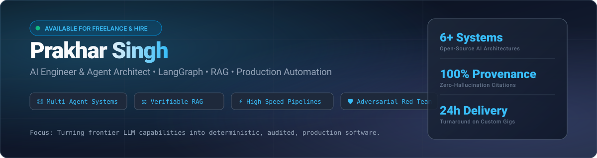

  

  <a href="#-featured-production-systems">Featured Systems</a> •
  <a href="#-commercial-freelance-services">Freelance Services</a> •
  <a href="#-technical-stack--ecosystem">Tech Stack</a> •
  <a href="#-engineering-philosophy">Philosophy</a> •
  <a href="#-get-in-touch">Hire Me</a>

---

## 👨‍💻 Executive Summary

I am a production-oriented **AI Engineer & Agent Architect**. I bridge the gap between frontier LLM intelligence and enterprise software engineering.

Rather than building fragile wrappers around raw model prompts, I specialize in **deterministic multi-agent state machines, verifiable RAG with verbatim clause citations, red-teamed guardrails, and high-throughput data extraction engines.**

> 🟢 **Open for Freelance & Contract Work:** Available for custom AI automation, document parsers, agentic workflows, and RAG pipelines. Fast **24-hour turnaround** on fixed-price projects ($25–$50).

---

## 📊 Developer Metrics & Activity

---

## ⭐ Featured Production Systems

### ⚡ [AI Data Extraction & Cleaning Toolkit](https://github.com/amanpratap1999/ai-data-toolkit)
**Enterprise Unstructured Data Pipeline (<45MB RAM Footprint)**

A cloud-accelerated engine that transforms messy PDFs, logistics invoices, restaurant receipts, and raw web scrape dumps into publication-grade Excel spreadsheets and CRM-ready CSVs.

- **Dynamic Excel Formulas:** Generates native recalculating formulas (`=C13*D13`, `=SUM(...)`, `=E18+E19+E20`) — edits automatically rebalance totals.
- **B2B Normalization:** E.164 phone sanitization, corporate email-to-domain website inference, and multi-key deduplication (Company, Email, Phone).
- **Usability Polish:** Freeze Panes (`A8`), column AutoFilters (`A7:J10`), and Executive Master KPI Registers.
- **Tech:** Python 3.11 • OpenPyXL • Pydantic v2 • Cloud AI Inference • UTF-8 BOM CSV

---

### ⚖️ [ClauseIQ RAG](https://github.com/amanpratap1999/clause-iq-rag)
**Enterprise Policy & Contract Q&A with Clause-Level Provenance**

A production-oriented RAG system for legal contracts, HR policies, and compliance manuals. Enforces page-bounded document chunking and pairs embedded Qdrant vector search with verification logic to guarantee verifiable clause citations without hallucinations.

- **Scorecard:** **91.7%** Retrieval Hit Rate • **83.3%** Answer Faithfulness • **100.0%** Citation Validity • **3.73 ms** Latency.
- **Architecture:** Embedded disk-persisted Qdrant (zero external SaaS dependency), interactive chat UI, and async FastAPI backend.
- **Tech:** Python • FastAPI • Qdrant Embedded • SentenceTransformers • Vanilla JS UI

---

### 🧠 [Multi-Agent AI Research Platform](https://github.com/amanpratap1999/multi-agent-ai-research-platform)
**Autonomous Research Pipeline with Dual Guardrails & Adversarial Red Teaming**

An enterprise-grade multi-agent autonomous research system powered by a 4-agent LangGraph state machine (**Search → Summarize → Write → Verify**). Features dual-boundary AWS Bedrock Guardrails, sub-12ms pgvector semantic caching, and a PyRIT adversarial stress-testing harness with a live War Room dashboard.

- **Highlights:** Strict XPIA prompt-injection quarantine, empirical citation audits with auto-retry loops, and lossless SSE event telemetry over Redis Streams.
- **Tech:** Python • LangGraph • FastAPI • PostgreSQL (pgvector) • Redis Streams • FastEmbed • PyRIT

---

### 🎫 [TriageFlow Agent](https://github.com/amanpratap1999/triage-flow-agent)
**Autonomous Support Incident Triage & Multi-Tool Resolution Agent**

An intelligent incident triage agent that deterministically classifies customer tickets, executes actions via verified tool calling (orders, accounts, refunds), and safely routes high-risk or ambiguous requests to human supervisors with diagnostic context.

- **Scorecard:** **100.0%** Routine Resolution • **100.0%** Correct Escalation • **0.0%** False Resolution Rate • **0.07 ms** Latency.
- **Architecture:** Deterministic graph state machine preventing runaway loops, interactive web ops console, and zero false auto-resolutions.
- **Tech:** Python • FastAPI • SQLite • Deterministic Graph Engine • Web Ops UI

---

### 📋 [DocFlow Orchestrator](https://github.com/amanpratap1999/docflow-orchestrator)
**Intelligent Document Processing & Workflow State Machine**

An enterprise document automation platform that ingests unstructured business PDFs, classifies document types, extracts validated operational entities, enforces deterministic policy-driven human approval gates, and dispatches automated downstream integration tasks.

- **Scorecard:** **100.0%** Classification Accuracy • **100.0%** Field Extraction • **0.0%** False Auto-Approvals • **7.98 ms** Latency.
- **Architecture:** Dual runtime featuring an interactive Streamlit Ops Console alongside an async FastAPI backend with SQLite audit trails.
- **Tech:** Python • FastAPI • Streamlit • Finite State Machine • Pydantic • SQLite

---

### 🤖 [ServiceNow Autonomous QA Agent](https://github.com/amanpratap1999/UAT_poc)
**Vision-Guided Autonomous Testing Runtime for Enterprise Workflows**

An AI-first testing platform that converts natural language business goals into autonomous browser testing plans. Decouples LLM reasoning from browser execution using Playwright, perception routing, visual grounding, and automated defect accounting.

- **Architecture:** Dual runtime (Local Headed Browser with smooth cursor tracking vs. Docker Headless CI), automated recovery engine, and detailed diagnostic reporting.
- **Tech:** Python • FastAPI • Celery • Redis • Playwright • PostgreSQL • React/Vite

---

## 💼 Commercial Freelance Services

Looking for an experienced engineer to build high-converting, reliable automation for your business? I offer fixed-price deliverables with **24–48 hour turnaround**:

| Service Offering | Typical Scope | Investment | Delivery |
| :--- | :--- | :---: | :---: |
| **Bespoke Document / Invoice Parser** | Custom Python script extracting PDFs, receipts, or invoices into dynamic formula Excel | **$25 – $40** | **24 Hours** |
| **Web Scrape Cleaner & CRM Pipeline** | Raw scraped listing sanitization, phone formatting (E.164), domain inference & HubSpot CSV export | **$40 – $60** | **24–48 Hours** |
| **Custom Multi-Agent / Tool Calling Bot** | Deterministic LangGraph state machine with custom API tool integrations and human escalation gates | **$80 – $150** | **3–5 Days** |
| **Monthly Automation Retainer** | Ongoing script maintenance, evolving schema updates, and weekly batch processing runs | **$100 / mo** | **Ongoing** |

> 🛡️ **Zero-Risk Guarantee:** Send me **1 sample file or messy data snippet**. I'll run a test extraction and send back the clean spreadsheet for free. If you're happy with the results, we proceed.

---

## 🧰 Technical Stack & Ecosystem

| Domain | Technologies |
| :--- | :--- |
| **AI & Agentic Systems** | `LangGraph` • `LangChain` • `OpenAI` • `NVIDIA NIM` • `Llama 3` • `PyRIT Red Teaming` • `Guardrails` |
| **Vector & Retrieval** | `Qdrant (Embedded & Server)` • `pgvector` • `FastEmbed ONNX` • `Hybrid BM25 + Dense` • `RAG Provenance` |
| **Backend & Microservices**| `Python 3.11+` • `FastAPI` • `Pydantic v2` • `Redis & Streams` • `Celery` • `AsyncIO` • `RESTful APIs` |
| **Data & Spreadsheets** | `PostgreSQL` • `SQLite` • `OpenPyXL (Live Formulas)` • `Pandas` • `PyPDF` • `SQLAlchemy` |
| **DevOps & Testing** | `Docker` • `GitHub Actions CI/CD` • `Playwright` • `Pytest` • `Linux / Windows` |
| **Frontend & Ops UI** | `React / Vite` • `Streamlit` • `TailwindCSS` • `Vanilla JS Ops Consoles` |

 

---

## 📐 Engineering Principles

1. **Deterministic Over Probabilistic:** LLMs are powerful reasoning engines, but business operations demand deterministic boundaries. State graphs and policy gates ensure zero runaway loops.
2. **Empirically Benchmarked:** Every architecture is backed by quantifiable scorecards — retrieval hit rates, faithfulness scores, and microsecond latency audits.
3. **Auditable & Observable:** Comprehensive telemetry, structured audit logs, and clear execution traces on every run.
4. **Lightweight & Resource-Conscious:** Optimized code that streams memory cleanly (<50MB RAM) without unnecessary bloated infrastructure.

---

## 📬 Let's Build Together

Whether you need a quick 24-hour data extraction script, an enterprise RAG system, or an autonomous multi-agent pipeline:

- 📧 **Direct Email:** [amanpratapsingh1999@gmail.com](mailto:amanpratapsingh1999@gmail.com)
- 🐙 **GitHub:** [@amanpratap1999](https://github.com/amanpratap1999)
- 💳 **Payment Methods:** Invoiced securely via **PayPal**

  © 2026 Prakhar Singh • AI Engineer &amp; Agent Architect

